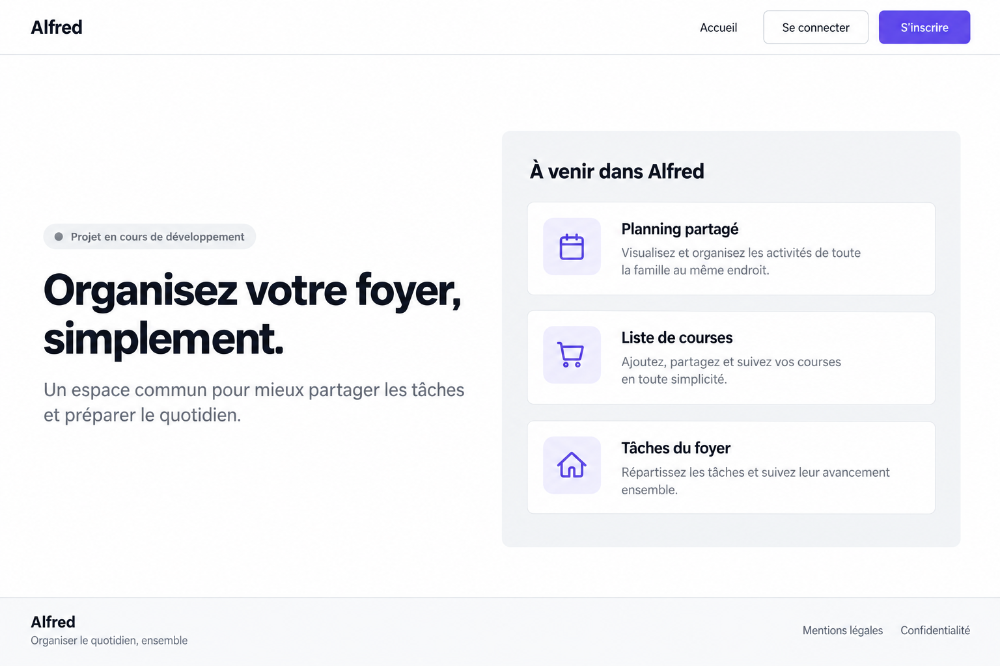

# Accueil public — référence desktop

Maquette de base validée le 2 novembre 2026 pour l’issue #16 : deuxième proposition desktop, avec présentation à gauche et fonctionnalités à droite. Le mobile reste à concevoir.

## Référence validée

- Navigation en haut : Alfred à gauche ; Accueil, Se connecter et S’inscrire à droite.
- Contenu principal en deux colonnes : statut du projet, titre et présentation à gauche ; panneau « À venir dans Alfred » avec trois cartes à droite.
- Footer en bas de page, après le contenu ; il ne doit pas le recouvrir.
- Base visuelle : composants daisyUI, couleurs sémantiques du thème par défaut dont primary, police système font-sans et mise en page Tailwind, conformément aux [guidelines](../../guidelines.md).

La composition est validée comme base de travail. Les couleurs exactes, ombres et détails générés ne remplacent pas les valeurs réelles de daisyUI. Les textes et liens légaux restent à affiner selon les contenus disponibles.

### Interactions et états

Les accès d’authentification sont placés dans le menu supérieur et conduiront aux pages correspondantes. Tant que ces pages sont absentes, leur indisponibilité doit être explicite, sans lien cassé. Les cartes des fonctionnalités à venir sont informatives. Aucun état de chargement métier n’est nécessaire pour cette présentation statique.

### Vérification

Inspection visuelle : navigation, deux colonnes et footer présents ; textes principaux lisibles. Le focus, la navigation clavier, les contrastes mesurés, le zoom et les largeurs desktop plus étroites restent à vérifier lors de l’implémentation. Aucune variante mobile n’est validée.

### Génération de la référence

ImageGen intégré. Brief : capture desktop de l’accueil public Alfred, navigation supérieure avec connexion et inscription, footer en bas, composants standards daisyUI clairs, police système ; deux colonnes avec « Organisez votre foyer, simplement. » à gauche et trois cartes Planning partagé, Liste de courses, Tâches du foyer sous « À venir dans Alfred » à droite ; sans illustration ni aperçu de tableau de bord.

## Explorations antérieures — non retenues comme référence finale

### Chaleureux

Ivoire, vert forêt, terre cuite ; titres à empattements, corps sans empattements. Ambiance domestique, illustration éditoriale et cartes douces.

### Essentiel

Blanc, bleu et marine ; typographie sans empattements, grille régulière, séparateurs et espaces généreux. Lecture directe et composants sobres.

### Vivant

Jaune pâle, prune et corail ; titres arrondis épais, blocs bordés et illustration familiale. Identité expressive.

## Intentions des explorations antérieures

En-tête, présentation du projet, aperçu illustratif des usages à venir, trois bénéfices et pied de page. Les aperçus ne sont pas des fonctionnalités publiques interactives. Les actions d’authentification indiquent leur indisponibilité tant que les parcours manquent ; retirer cet état lorsque les parcours seront disponibles.

Sur mobile : empiler les sections, préserver les actions principales et simplifier les aperçus plutôt que réduire leurs textes. Les liens de pied de page sont des intentions à confirmer selon les contenus réellement disponibles.

## Vérification et limites

Inspection visuelle des trois planches : hiérarchie et distinction des palettes présentes. Les petits textes des aperçus restent trop denses pour servir de spécification mobile finale. Les logos, illustrations et textes secondaires sont exploratoires. Les contrastes mesurés, le zoom, le focus, le clavier et les états interactifs devront être vérifiés sur l’interface implémentée. Aucun état de chargement métier nécessaire pour cette page de présentation statique.

## Génération

Outil : ImageGen intégré. Brief commun : maquette haute fidélité française de la page publique Alfred, vue desktop et mobile, titre « Un foyer organisé, un quotidien plus léger. », présentation du foyer, inscription et connexion provisoirement indisponibles, aperçu explicitement marqué « fonctionnalités à venir », bénéfices Planifier/Partager/Simplifier ; sans métriques ni témoignages inventés.

Variantes du brief : Chaleureux — ivoire #FAF7F0, forêt #214D3C, terre cuite, serif éditoriale et illustration domestique ; Essentiel — blanc, marine #172B4D, bleu #315EE8, sans-serif et grille minimale ; Vivant — jaune #FFF8DD, prune #382445, corail #E86B4B, typographie arrondie et composition modulaire.

Aucune implémentation frontend réalisée dans ce travail de conception.
