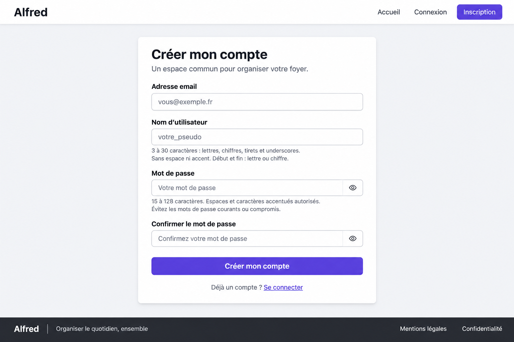
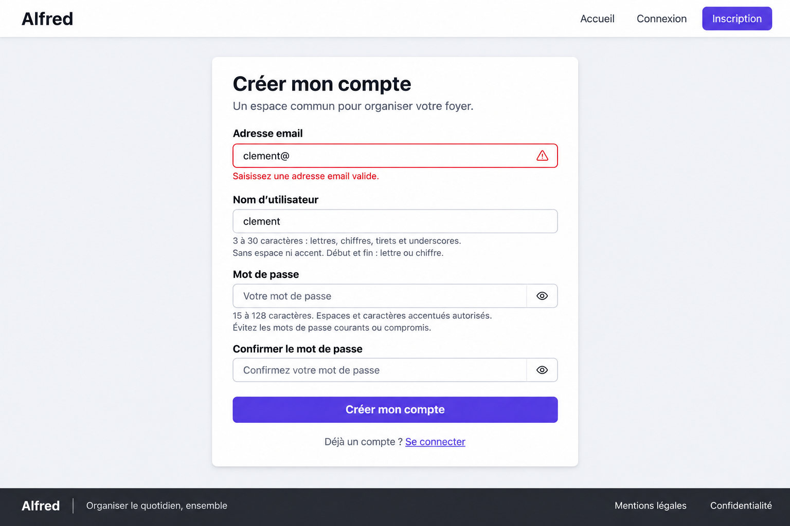
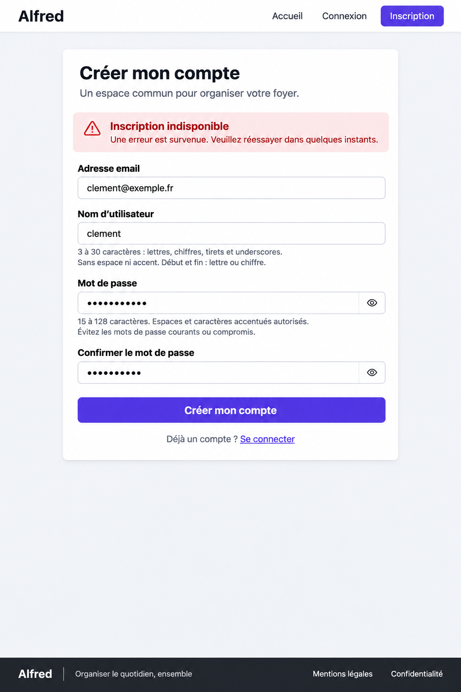
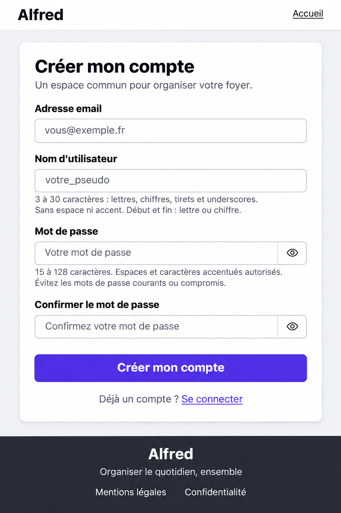

# Inscription — référence et déclinaisons

Statut : proposition A (carte centrée) validée le 3 novembre 2026 pour l’issue #20. Déclinaisons erreur et mobile livrées, en attente de retour. Base : [guidelines](../../guidelines.md). Aucun frontend implémenté.

## Référence desktop validée

## Déclinaisons

### Erreur de saisie

Email incomplet « clement@ » : bordure d’erreur, pictogramme et message « Saisissez une adresse email valide. » sous le champ. Afficher après interaction ou tentative d’envoi ; associer le message au champ et signaler son invalidité aux technologies d’assistance. Aucun état de succès artificiel sur les autres champs.

### Email déjà utilisé — erreur métier backend

L’adresse est syntaxiquement valide mais refusée par le backend car déjà associée à un compte. Afficher « Cette adresse email est déjà utilisée. » sous l’email, avec bordure d’erreur et association accessible au champ. Ne pas présenter ce conflit comme une panne serveur. Le même principe s’applique au username déjà utilisé, sous son propre champ. Si les deux conflits sont renvoyés, afficher les deux erreurs. À la modification du champ, retirer l’erreur métier devenue obsolète sans annoncer la disponibilité avant une nouvelle vérification ; ignorer une réponse tardive visant une ancienne valeur. Les autres valeurs restent saisies, les mots de passe restent masqués et uniquement en mémoire du formulaire.

Brief d’édition ImageGen : conserver la référence A et remplacer uniquement l’état du formulaire par une erreur métier après soumission, email clement@exemple.fr avec message local de doublon, autres champs neutres, sans alerte de panne générale. Inspection visuelle : erreur associée au bon champ, footer et formulaire sans recouvrement ; accessibilité interactive à vérifier lors de l’implémentation.

### Indisponibilité serveur

Alerte générale « Inscription indisponible » au-dessus des champs, sans attribuer l’échec à un champ ni révéler de détail technique. Le bouton permet de réessayer lorsque la requête précédente est terminée ; annoncer l’alerte. Le formulaire reste dans la page, sans recouvrement du footer. Les mots de passe masqués restent uniquement en mémoire du formulaire pendant la tentative ; ne pas les persister. Une erreur réseau à résultat incertain ne doit pas affirmer que le compte n’a pas été créé.

### Mobile

Formulaire en colonne, marges latérales, aides avec retour à la ligne et action pleine largeur. Navigation simplifiée proposée : Alfred et Accueil dans le header, accès Connexion sous le formulaire. Footer empilé dans le flux normal ; défilement vertical autorisé. Cette adaptation de navigation reste à valider.

### Inspection des déclinaisons

Les quatre champs, les aides, les actions et le footer sont présents. L’erreur champ est localisée et l’erreur serveur distincte. La capture serveur est plus haute que la référence : sa hauteur n’est pas une dimension fixe à reproduire. La version mobile est une image haute résolution représentant une petite largeur logique, pas une spécification de dimensions en pixels. Contrastes, tailles réelles des cibles, comportement au clavier et avec zoom à vérifier sur l’implémentation.

## Objectif

Créer un compte avec email, username, mot de passe et confirmation. La connexion automatique et l’envoi du mail sont des étapes ultérieures ; ne pas les annoncer comme effectifs après cette première inscription.

## Propositions

### A — Carte centrée

Une carte unique concentre la saisie ; largeur limitée et espaces réguliers. Composition retenue.

### B — Deux colonnes

Présentation à gauche, formulaire à droite ; continuité avec l’accueil desktop retenu. Davantage d’espace horizontal nécessaire.

## Structure et styles

Header et footer communs conservés. Quatre champs empilés avec labels persistants, aides de saisie et bouton principal. Police système ; composants standards daisyUI ; primary, base et neutral du thème. Les couleurs exactes, ombres et gradients éventuels générés restent indicatifs : utiliser les valeurs réelles de la bibliothèque.

## Règles et interactions

- Email : format valide, 254 caractères maximum après normalisation ; espaces extérieurs retirés et conversion en minuscules côté backend.
- Username : 3 à 30 caractères, a-z, chiffres, tirets et underscores ; début et fin alphanumériques, conversion en minuscules côté backend. Affiner l’aide affichée pour préciser a-z et la conversion des majuscules.
- Mot de passe : 15 à 128 caractères, espaces et accents autorisés, pas de catégorie imposée ; refus des mots de passe courants ou compromis côté backend.
- Confirmation identique au mot de passe, conservée dans le formulaire.
- Boutons œil : afficher/masquer indépendamment chaque mot de passe, avec nom accessible et sans soumettre le formulaire.
- Envoi : indiquer « Création en cours… », empêcher une seconde soumission et annoncer le résultat.
- Erreurs : sous le champ après interaction ou tentative de soumission, sans s’appuyer uniquement sur la couleur ; associer aides et erreurs aux champs. Préserver les informations non sensibles en cas d’échec.
- Erreur serveur/réseau : message général lisible et possibilité de réessayer.
- Succès : confirmation « Votre compte a été créé. », sans annoncer de session ni d’email envoyé.
- Lien Connexion : destination réelle lorsqu’elle existe ; indisponibilité explicite dans l’intervalle.
- Ne pas bloquer le collage ni les gestionnaires de mots de passe.

## Responsive et vérifications

Une déclinaison mobile de A est désormais disponible ci-dessus ; elle reste à valider. B reste une exploration non retenue.

Inspection visuelle : champs, aides, actions, header et footer présents et lisibles sur les deux propositions. Les captures ne prouvent pas les contrastes mesurés, le clavier, les annonces d’erreur ou la tenue avec zoom ; vérifier ces points lors de l’implémentation. Les états envoi et succès restent décrits textuellement, sans maquette dédiée.

## Génération

Outil : ImageGen intégré. Brief : capture desktop française d’inscription Alfred, composants standards daisyUI clairs, police système, header commun et footer sombre ; email, username, mot de passe et confirmation avec labels et aides conformes aux règles ci-dessus, boutons œil, bouton « Créer mon compte » et lien Connexion ; sans illustration, connexion sociale ou promesse de session automatique. Variante A : carte centrée. Variante B : présentation à gauche et carte à droite.

Déclinaisons réalisées par édition de A avec ImageGen intégré : conserver sa composition ; erreur champ sur email incomplet avec message local ; erreur serveur avec alerte générale et valeurs conservées ; adaptation mobile avec champs empilés, navigation simplifiée et footer dans le flux. Fichiers PNG conservés sans modification du frontend.
